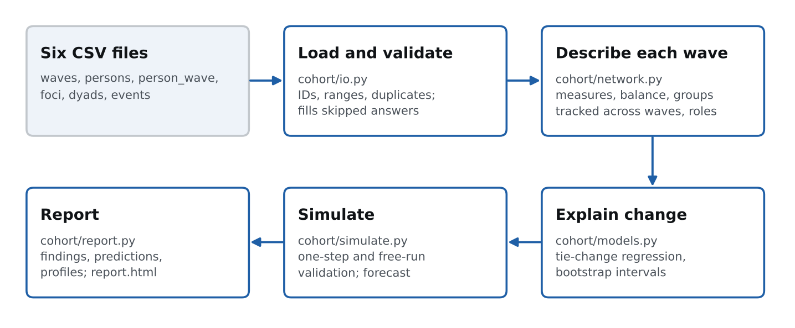

# How the model works

## The idea

The earlier version of this project drew the cohort as one graph. A single graph cannot
show that friendships form in the dorm in semester 1 and dissolve once people move out,
that a breakup in semester 2 turns two friend groups against each other, or that one
person thinks a friendship is close while the other does not. This model treats the
cohort as a **network that changes over time, with several kinds of relationship at
once, negative ties as well as positive ones, and a separate view from each side of
every pair**.

It has four parts that build on each other:

| Part | Question it answers | Method |
|---|---|---|
| A. Data model | What happened, and when? | People, contexts, five relationship layers and dated events, all per survey wave |
| B. Description | What did the network look like at each wave? | Snapshot measures, homophily, structural balance, groups tracked across waves, roles |
| C. Explanation | Why did ties form, weaken or turn hostile? | Tie-change regression (pilot); stochastic actor-oriented model (RSiena) for the full study |
| D. Simulation | Can we reproduce the history, and what comes next? | Agent-based model built from the fitted effects, validated on the observed waves, then run forward |

A last layer reads the results against psychology and sociology theory, and a report
turns everything into figures and plain-language findings.



## A. The data model

### Waves

Time is measured in **survey waves**. For a semester structure, two waves per semester
(middle and end) catch changes that one wave per semester would average away. The pilot
uses four waves over two semesters. The full study has six semesters, so it would have
6 to 12 waves.

### Relationship layers

At each wave, every person rates every other person on five layers. The ratings are
**directed**: P04's rating of P08 and P08's rating of P04 are separate numbers. The gap
between them is data, because unreturned feelings are where a lot of drama starts.

| Layer | Scale | Meaning |
|---|---|---|
| friendship | 0–5 | 0 do not know them, 1 acquaintance, 2 friendly, 3 friend, 4 close friend, 5 best friend |
| trust | 0–5 | would tell them something private |
| hostility | 0–5 | 0 none, 1 irritation, 3 open dislike, 5 enemy |
| romantic | 0–3 | 0 none, 1 interest or crush, 2 dating, 3 ex |
| contact | 0–5 | how often they actually interact, 0 never to 5 daily |

Friendship and hostility are separate scales on purpose. Two people can be close and in
conflict at the same time, and a single "relationship score" would hide that.

### Tie definitions

The analysis turns ratings into ties with fixed rules:

- **Friendship tie**: the mean of the two friendship ratings is 3 or more.
- **Hostile tie**: the mean of the two hostility ratings is 2 or more, or either side rates 3 or more. Hostility overrides friendship.
- **Signed tie**: +1 for friendship, −1 for hostility, 0 otherwise. This is the matrix the balance analysis uses.
- **Couple**: both rate romantic = 2. **Exes**: both rate 3. **Interest**: one rates 1 (marked mutual if both do).

### Contexts

A context (in sociology, a *focus*) is anything that puts people in the same place
regularly: a dorm block, a class section, an online group, a study group, a rented flat,
a student association. Membership is recorded per wave, because people move out, change
section and leave chats. A context that includes everyone, such as the whole class's
group chat, carries no information about who meets whom, and the loader ignores it.

### Events

Dated incidents such as starting to date, a breakup, a public fight, a rejection,
moving house, a group forming or going silent, or someone helping someone. Each has
actors, third parties who were involved, and an intensity from 1 to 5. Event types are
classed as positive or negative so the model can use them.

## B. Describing each wave

### Cohort measures

| Measure | Definition | What it shows |
|---|---|---|
| Density | share of directed pairs with friendship ≥ 3 | how connected the cohort is |
| Reciprocity | share of directed friendship ties that are returned | mutual versus one-sided friendship |
| Transitivity | closed triangles ÷ connected triples, on friendship ties | how clustered into groups |
| Friendship / hostile ties | counts of undirected signed ties | the size of each side |
| Tension | unbalanced triangles ÷ all fully signed triangles | how much drama the structure holds |
| E-I index | (ties between categories − ties within) ÷ all ties | homophily by gender, housing, origin; −1 all within, +1 all between |
| Context share | share of friendship ties whose two people share a context | how much the environment explains |
| Stability | Jaccard overlap of friendship ties with the previous wave | how much the network reshuffles |
| Perception gap | mean of \|A→B − B→A\| | how differently pairs see their relationship |

Each E-I index is compared with the value random mixing would give, which depends on
the group sizes. A cohort with 6 men and 4 women has a random gender E-I of +0.07, not 0.

### Structural balance

Heider's balance theory says some triangles of relationships are stable and others are
not. With signs on all three sides:

- **+ + +** (three friends) and **+ − −** (two friends with a shared enemy) are balanced.
- **+ + −** (one person is friends with two people who are hostile to each other) is unbalanced. The person with the two positive ties is **caught in the middle**. These triangles tend to resolve: the middle person drops one side, or the two sides reconcile.
- **− − −** is weakly unbalanced and rare.

The **tension** measure is the share of fully signed triangles of the + + − kind. The
model also records who is in the middle of each one.

### Groups and how they change

At each wave, groups are found with the Louvain method on friendship strength
(mean rating 2 or more, hostile pairs excluded), keeping the best of 40 random starts
by modularity. Groups found at different waves are then matched by member overlap
(Jaccard ≥ 0.34), so a group keeps its name while most of its members stay. Each change
is labelled: **formed** (and from which earlier groups), **split**, **dissolved**,
**changed** (who joined, who left) or **stable**.

### Roles

Each person gets one or more roles per wave from their position in the network:

| Role | Rule |
|---|---|
| hub | friendship ties ≥ max(3, mean + 1 SD) |
| broker | among the top two in betweenness centrality, and above 0.15 |
| caught in the middle | holds the two positive ties of a + + − triangle |
| in open conflict / one enemy | two or more / exactly one hostile tie |
| peripheral | one friendship tie or none |
| group member | none of the above |

## C. Explaining change: the tie-change model

For every directed pair (i rating j) and every pair of consecutive waves, the outcome
is the change in i's friendship rating of j:

```
ΔF_ij(t→t+1) = β0 + Σ_k β_k · x_k(i, j, t) + ε
```

The explanatory variables are measured at the earlier wave, except contexts and events,
which are measured over the interval:

| Variable | Theory it tests |
|---|---|
| Current friendship level | state dependence: strong ties have less room to grow |
| j rates the tie higher than i does | reciprocity: people adjust toward the other side |
| Common friends | triadic closure: friends of friends become friends |
| Shared contexts at the next wave | propinquity and focus theory |
| Shared contexts × semester 2 | do contexts matter less once everyone knows everyone? |
| Lost a shared context | moving out, changing section |
| Same gender, same housing type | homophily |
| GPA gap | academic homophily |
| Attractiveness of j | attraction and status |
| Hostility between them | conflict erodes friendship |
| Unbalanced triangles through the tie | balance pressure |
| Negative / positive events between them | the shock of a breakup, fight, new relationship or help |

The model is fitted by ordinary least squares on standardized variables, so each effect
reads as "rating points per standard deviation". Uncertainty comes from 2,000 bootstrap
resamples over pairs: both directions and all waves of a pair are drawn together,
because they are not independent. An effect counts as **clear** when its 90% interval
does not cross zero.

This regression is a deliberately simple stand-in. On the full 30-person dataset the
standard method is the **stochastic actor-oriented model (SAOM, R package RSiena)**. It
models tie changes as choices people make, handles the dependence between ties
properly, and can model network and behaviour (for example GPA) changing together.
The variables above map directly onto RSiena effects (reciprocity, transitive triplets,
same-covariate, covariate-alter, dyadic covariates), so the pilot's design carries over.

## D. Simulation

The simulation is an agent-based model. Each person is an agent carrying their
attributes and current ratings. One simulation step is one survey wave, and it runs in
this order:

1. **Breakups.** Each couple breaks up with probability p_break, which doubles while either partner is interested in someone else. A breakup sets both to "ex" and adds hostility, more on the side that was hurt. Close friends of one partner (rating 4 or more, and clearly closer to that side) take sides with probability 0.40.
2. **New couples.** Mutual interest between two single people becomes a relationship with a probability estimated from the data. Extraverts are more likely to act on it and introverts less. An ex of either person may react with hostility toward the new partner (probability 0.60).
3. **Interest.** One-way interest is returned with a probability that rises with the admirer's attractiveness and the existing friendship. Otherwise it fades. New interest appears between people who meet, at a rate estimated from the data, and less often toward someone who is taken.
4. **Escalation.** Pairs who already dislike each other and still meet may fight, which adds hostility and counts as a negative event.
5. **Friendship.** Every rating moves by the fitted tie-change model plus noise. The noise is partly shared by both directions of a pair, so a pair's two ratings tend to move together.
6. **Fading.** Hostility decays by 15% per wave unless something feeds it.
7. **Balance.** In each unbalanced triangle, the person in the middle drifts away from one side with probability 0.30.

### Where the numbers come from

| Rate | Source |
|---|---|
| All friendship effects and the noise level | fitted tie-change model |
| Breakup hazard | event log: breakups ÷ months in a relationship, with a Gamma(1, 12) prior (about one breakup per couple-year) |
| New interest | romantic layer: new interest ÷ opposite-gender pairs at risk, with a Beta(1, 30) prior |
| Mutual interest → couple | romantic layer, with a Beta(2, 4) prior |
| Side-taking 0.40, jealousy 0.60, rivalry 0.35, fights 0.15, hostility decay 0.85, balance resolution 0.30 | assumptions for the pilot; to be estimated from the full data |

The priors keep a tiny dataset from producing extreme rates. In the pilot, two of two
mutual interests became couples; without a prior the model would assume this always
happens.

## Validation

Two tests run on the observed waves before any forecast is trusted:

- **One-step-ahead.** Start from each real wave, simulate the next one 300 times, and score the predicted probability of every friendship tie against what was observed, using the Brier score (mean squared error of a probability; lower is better). The baseline assumes every tie stays exactly as it was.
- **Free run.** Start from the first wave and let the model generate everything after it, including the romance and conflict, 500 times. Then check whether the observed cohort measures fall inside the middle 80% of simulated histories.

## Forecast

The forecast starts from the last observed wave and runs a given number of waves ahead
(two by default), 1,000 times. Each run gets its own plausible future contexts: homes,
dorms and flats stay as they are, class sections are reshuffled at random, the study
group continues with probability 0.75 and the association with probability 0.70. The
outputs are probabilities: each pair being friends or hostile at the end, each pair
dating at some point, current couples surviving, unbalanced triangles resolving one way
or the other, each person's expected number of friends and isolation risk, the most
likely group structure, and the range of each cohort measure.

## Psychological and sociological reading

| Pattern | Theory |
|---|---|
| First friendships form inside dorms, sections and chats | Focus theory (Feld 1981); propinquity (Festinger, Schachter & Back 1950) |
| People befriend people like them; this weakens with contact | Homophily (McPherson, Smith-Lovin & Cook 2001); contact hypothesis (Allport) |
| A tie moves toward how the other side rates it | Reciprocity norm (Gouldner 1960); social exchange |
| Friends take sides after a breakup | Structural balance (Heider 1946; Cartwright & Harary 1956) |
| People between groups gain visibility and risk | Structural holes (Burt 1992); weak ties (Granovetter 1973) |
| Losing your context means losing friends | Dunbar layers; the cost of maintaining ties |
| Unequal investment in a relationship | Perception asymmetry; attachment |
| Groups form, clash, then settle | Group development (Tuckman 1965) |

## From the pilot to the full study

1. Collect the real data in the format in the [data guide](DATA_GUIDE.md): 30 people, 6 semesters, ideally two waves per semester.
2. Run the pipeline unchanged first. Every descriptive output works at any size.
3. Fit RSiena on the friendship and hostility layers with the same effects, including time-dummy effects to test whether contexts matter less after year 1.
4. Fit a relational event model on the event log to model cascades (a breakup followed by side-taking followed by fights) directly.
5. Re-estimate the simulation's rule rates from the real data, and check the validation tests again before reading the forecast.
