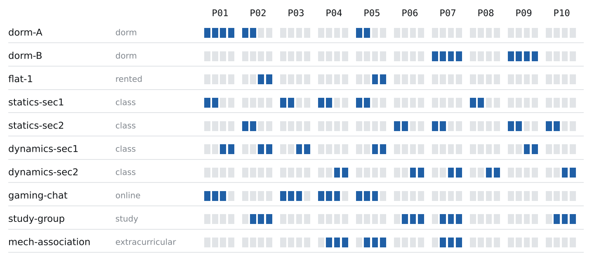
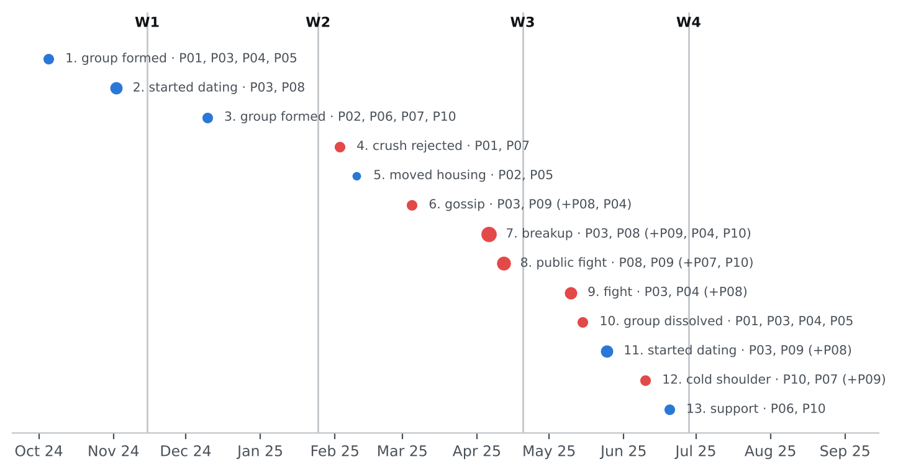
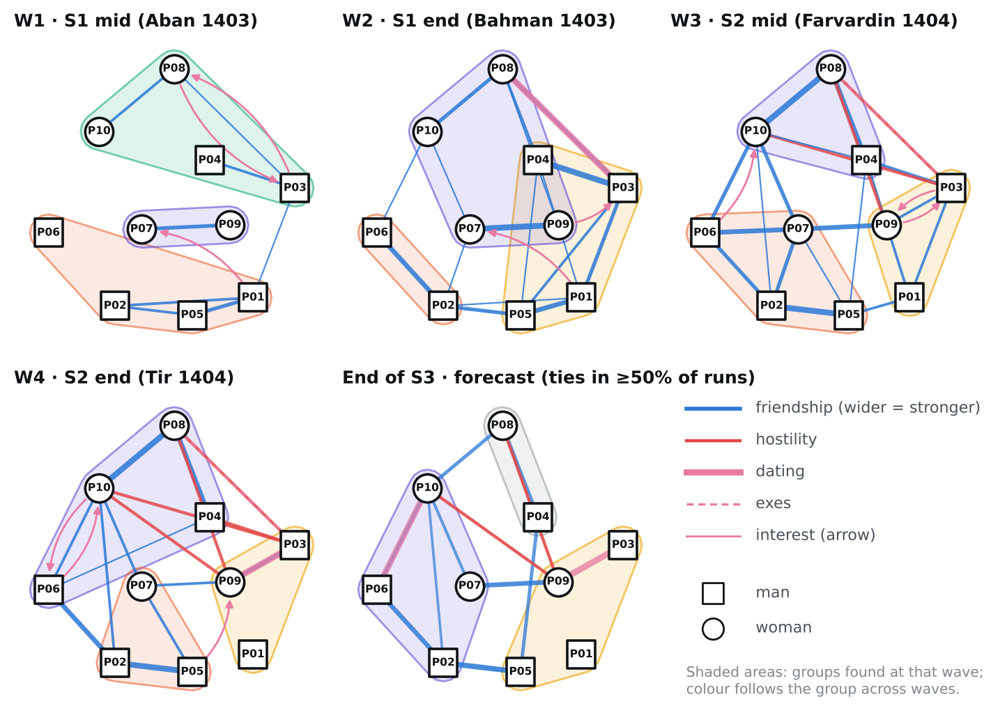
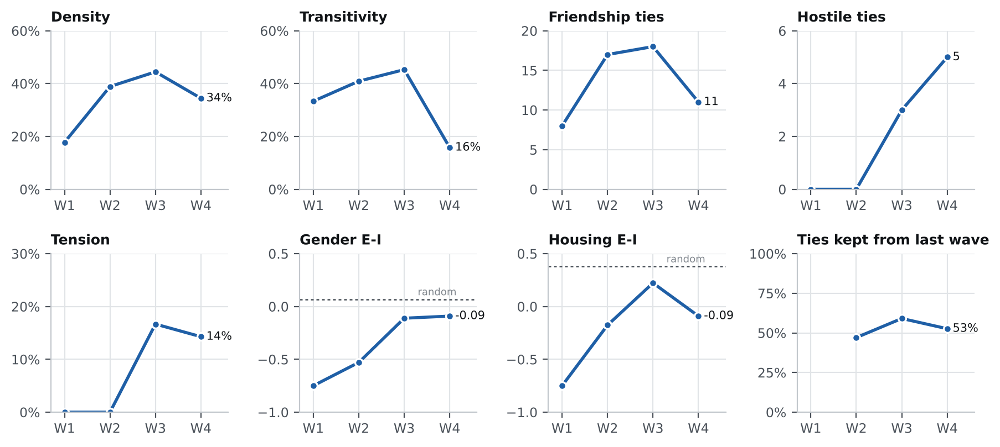
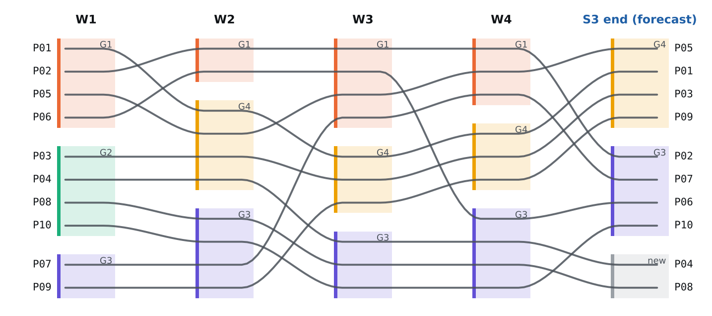
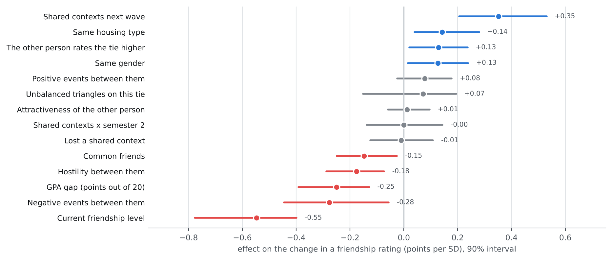
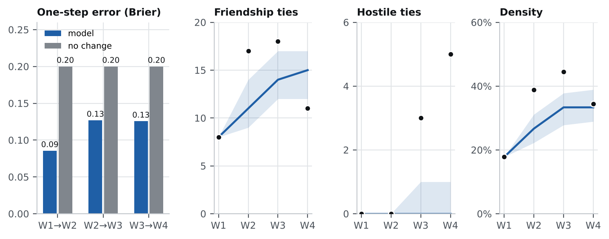
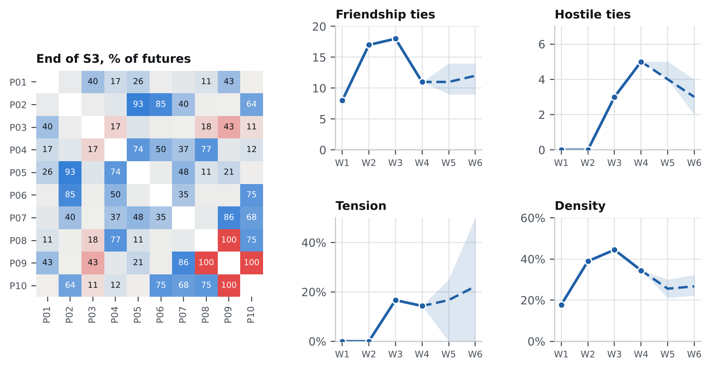

# The pilot test

## Why a fake cohort

Before real data from 30 people is collected, the pipeline needs a test where the right
answer is known. So we wrote a story about 10 invented students over their first two
semesters, turned it into the survey answers those students would plausibly have given,
fed only those answers to the pipeline, and checked what it found against what we had
planted.

All people, ratings and events in this test are invented. The data is in
`data/example_10p_2sem/` and the generator is `examples/make_example_data.py`. The
pipeline never reads the generator, only the six CSV files.

## The invented cohort

Ten students enter AUT mechanical engineering in Mehr 1403 (September 2024): six men
and four women. Five are from Tehran and live with family; the others came from other
cities and live in the dorms, men in block A and women in block B.

| ID | Gender | From | Housing | GPA S1 → S2 | Personality | Role in the story |
|---|---|---|---|---|---|---|
| P01 | M | Isfahan | dorm | 15.1 → 13.8 | very extraverted | the early connector who is left behind |
| P02 | M | Tabriz | dorm → rented flat | 17.9 → 18.2 | introverted, conscientious | studious; moves out with P05 |
| P03 | M | Tehran | family | 14.2 → 13.1 | extraverted, low agreeableness, most attractive man | at the centre of both romances |
| P04 | M | Tehran | family | 15.6 → 15.9 | agreeable, calm | P03's best friend who ends up on the other side |
| P05 | M | Mashhad | dorm → rented flat | 15.0 → 15.4 | agreeable, stable | the bridge; quietly interested in P09 |
| P06 | M | Tehran | family | 18.6 → 18.9 | very introverted, top GPA | study group; slowly drawn to P10 |
| P07 | F | Shiraz | dorm | 17.4 → 17.8 | extraverted, agreeable | study group; rooms with P09; caught in the middle |
| P08 | F | Tehran | family | 15.4 → 14.6 | most attractive, highest neuroticism | dates P03; the breakup |
| P09 | F | Rasht | dorm | 14.8 → 14.5 | attractive | P03's next girlfriend |
| P10 | F | Tehran | family | 18.1 → 18.4 | introverted, conscientious | P08's best friend; study group |



## The story

**Semester 1, first weeks.** Friendships form where people meet. The dorm-A men
(P01, P02, P05) become a unit. The Tehran men in statics section 1 (P03, P04) start a
gaming chat with P01 and P05, which makes P01 a hub between the dorm and Tehran
circles. P07 and P09 share a room in dorm B. P08 and P10 are friends from home. P03 and
P08 are interested in each other.

**Semester 1, later.** P03 and P08 start dating in November. Before the midterms the
strongest students (P02, P06, P07, P10) form a statics study group, the first
friendships that cross the gender line. P01 develops a crush on P07.

**Between semesters.** P07 turns P01 down in February. The same week P02 and P05 leave
the dorm and rent a flat together. P01 stays behind in dorm A, alone.

**Semester 2.** The class sections are reshuffled. P03 and P09 land in the same
dynamics section and are seen together often; the gossip reaches P08 in March. Right
after the Nowruz break P03 and P08 break up (intensity 5). Within a week P08 and P09
have a public fight. P10 sides with her best friend P08. P04, now in P08's section,
defends her, and fights with P03 in May. The gaming chat goes silent. P03 and P09
start dating at the end of May. P10 gives P07 the cold shoulder for still rooming with
P09. Meanwhile, P06 helps P10 prepare for exams, and by the end of the semester they
are interested in each other. P05 has a crush on P09 and has told no one.



## From story to survey answers

Real survey answers are noisy, so the generator does not simply copy the story. For
every rating it adds:

- **personal rating style:** extraverts rate everyone a little higher (+0.25 per point of extraversion above 3);
- **recall noise:** about one rating in five is off by one point in either direction;
- **perception gaps:** some people see a friendship as closer than the other side does (P01 about his old dorm-mates, P04 about P08, P09 about P07);
- **stray irritations:** a 3% chance of a hostility rating of 1 that the story never planned;
- **skipped answers:** P06 skipped two ratings at W1 and P03 skipped one at W3.

Trust and contact are derived from friendship, hostility, agreeableness and shared
contexts, with their own noise. The result is 1,785 ratings, 13 events, 133 context
memberships and 40 person-wave records.

## The run

```
python run_analysis.py data/example_10p_2sem
```

```
[warning] dyads: 3 skipped answers imputed from the other person's rating of the same tie
loaded 10 people, 4 waves, 1785 ratings, 13 events
tie-change model: R2=0.49 on 270 pair-transitions
    65%  P06 and P10 start dating
    45%  P03 and P09 break up
    29%  P07 sides with P09 and drifts from P10
    84%  P03 ends S3 with at most one friend
    53%  P01 ends S3 with at most one friend
    43%  New hostility between P03 and P09
    49%  Existing hostilities last through S3
```

The validator found the three skipped answers and filled them. A full run (2,000
bootstrap samples, 300 runs per one-step test, 500 free runs, 1,000 forecast runs) takes
about ten seconds.

## What the pipeline saw

### The network, wave by wave



| | W1 | W2 | W3 | W4 |
|---|---|---|---|---|
| Friendship ties | 8 | 17 | 18 | 11 |
| Hostile ties | 0 | 0 | 3 | 5 |
| Density | 18% | 39% | 44% | 34% |
| Transitivity | 33% | 41% | 45% | 16% |
| Tension | 0% | 0% | 17% | 14% |
| Gender E-I (random: +0.07) | −0.75 | −0.53 | −0.11 | −0.09 |
| Ties inside a shared context | 88% | 88% | 100% | 100% |
| Ties kept from previous wave | | 47% | 59% | 53% |
| Couples | 0 | 1 | 0 | 1 |

The cohort grows denser through semester 1, peaks at W3, then contracts sharply: eight
friendship ties are lost between W3 and W4 and only one is gained. Triangles of friends
break up (transitivity falls from 45% to 16%) as hostility spreads.



### Groups



- **W1:** three groups that follow housing and home city: the dorm men with P06 (G1), the Tehran circle of P03, P04, P08 and P10 (G2), and the dorm-B roommates (G3).
- **W2:** the first-semester groups split. The gaming chat pulls P01, P03, P04 and P05 into a new G4. The women merge into one group (G3). P02 and P06 are left as the study-group core (G1).
- **W3:** after the breakup the groups re-sort along the conflict. P03 and P09 are grouped with P01; P04 joins P08 and P10.
- **W4:** P04 is now firmly with P08, P10 and P06. P01, P03 and P09 form the "new couple and the left-behind" group. P02, P05 and P07 form the flat-and-association group.

### Roles

P01 and P03 are both hub and broker at W1. By W4, P01 is peripheral with no friendship
ties, and P03 is in open conflict with three people. P04 is caught in the middle at W3
(between P03 and P08). P07 is caught in the middle at W4 (between P09 and P10). P10
goes from peripheral at W1 to hub and broker at W4.

### Why ties changed



Clear effects:

- **Shared contexts** (+0.35): the strongest positive force.
- **Similar GPA** (gap −0.25): the study group is visible in the numbers.
- **The other person rates the tie higher** (+0.13): ratings move toward each other.
- **Same housing type** (+0.14) and **same gender** (+0.13).
- **Negative events** (−0.28) and **hostility** (−0.18).
- **Current level** (−0.55): high ratings tend to fall back, low ones to rise.
- **Common friends** (−0.15): negative, the opposite of what triadic closure predicts. With 10 people this most likely reflects the collapse of whole friend triangles at W4, not a real effect.

No clear effect: attractiveness, losing a context, positive events, unbalanced
triangles, and shared contexts × semester 2.

## Planted versus found

This is the real test: for each thing written into the story, did the pipeline find it
from the survey answers alone?

| Planted in the story | What the pipeline found | Verdict |
|---|---|---|
| First friendships come from dorms, sections and chats | 88% of W1 ties share a context; shared context is the strongest positive effect (+0.35) | Found |
| Gender-separated start, mixing through the study group and romance | Gender E-I from −0.75 to −0.09, near random (+0.07) | Found |
| P03–P08 relationship and breakup | Couple at W2, exes from W3, hostility P08→P03; negative events −0.28 | Found |
| Side-taking after the breakup | Hostile ties 0 → 3 → 5: P08–P09, P09–P10, P03–P04, P03–P10 | Found |
| P04 between his best friend and P08 | P04 "caught in the middle" at W3, hostile with P03 at W4 | Found |
| P07 between roommate P09 and study partner P10 | Unbalanced triangle at W4 with P07 in the middle; forecast 57% still stuck | Found |
| P02 and P05 move out and P01 is left behind | P01 from hub (3 ties) to 0 ties; 53% isolation risk forecast | Found, but the "lost a context" effect itself is near zero: the model sees the loss through other variables |
| P01 invests more than he gets back | Largest perception gaps: P01 rates P02 and P03 at 3, gets 1 back | Found |
| Study group P02, P06, P07, P10 | Visible in the GPA effect and in P02–P06 staying together; never detected as one group, because the women's own ties were stronger | Partly found |
| P06–P10 mutual interest at the end | 65% chance they start dating in S3 | Found as a forecast |
| P05's secret crush on P09, who is taken | Recorded as one-way interest, but almost no consequence in the forecast (P05–P09 couple 2%, no rivalry with P03) | Missed |
| Contexts matter less in semester 2 | No effect (0.00); every W3 and W4 friendship still shared a context, so the story did not really contain this | Not testable with this data |

Of the twelve planted patterns, the pipeline found eight, found two partly, missed one,
and one could not be tested with this data.

## Does the model hold up?



**One step ahead,** the model halves the error of assuming no change: Brier 0.09, 0.13
and 0.13 against 0.20 for the no-change baseline at each step. But of the 27 friendship
ties that appeared or disappeared, it put more than 50% on the right outcome for only 8.
It knows which ties are fragile better than it knows which ones will actually flip.

**Run freely from W1,** it reproduces density, transitivity, gender mixing, tension and
the number of couples within its 80% range at W4. It misses three things: it predicts
15 friendship ties where there were 11, a mean friendship of 2.38 where there was 1.99,
and almost no hostile ties where there were 5. In the free run the breakup happens in
about four runs out of ten, and when it does, the side-taking stays mostly below the
hostility threshold. The cascade that drove the real semester 2 is a specific chain of
events, and the model, started a year earlier, does not reproduce it. This is the main
weakness to fix with real data: the side-taking and jealousy rates are assumptions, and
they appear to be too weak.

## Forecast for semester 3



| Chance | Prediction |
|---|---|
| 65% | P06 and P10 start dating |
| 45% | P03 and P09 break up; 43% that the two become hostile |
| 84% | P03 ends semester 3 with at most one friend |
| 53% | P01 ends semester 3 with at most one friend |
| 57% / 29% / 11% | P07 is still caught in the middle / sides with P09 / sides with P10 |
| 100% | P08–P09 and P09–P10 stay hostile |

The most likely group structure at the end of semester 3 has three parts: P01, P03, P05
and P09; P02, P06, P07 and P10; and P04 with P08.

## What we learned for the real study

1. **The pipeline works end to end** on data shaped like the real survey, including skipped answers.
2. **Structure is easier than drama.** Contexts, homophily and group change were found reliably. Conflict depends on specific events, so the event log matters as much as the ratings. Collect it carefully.
3. **Two waves per semester are worth it.** Most of the story happened between waves of the same semester.
4. **The rule rates need data.** Side-taking, jealousy and hostility decay are guesses in this pilot, and the free run shows the guesses are too low. With 30 people and 6 semesters they can be estimated.
5. **Ten people is too few for firm effects.** The negative common-friends effect shows how a small sample can produce a misleading sign. Read the pilot's numbers as a test of the machinery, not as findings.
